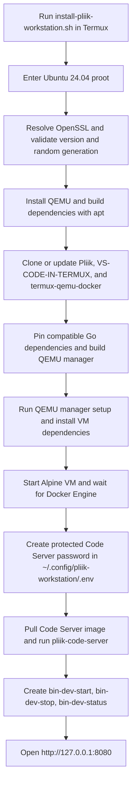

# Pliik Workstation Architecture

Pliik Workstation uses Termux to bootstrap an Ubuntu 24.04 proot. Ubuntu hosts QEMU, which runs an Alpine VM; Docker and Code Server run inside that VM. QEMU uses software TCG acceleration because Android proot does not expose KVM.

## Runtime architecture

```mermaid
flowchart TB
    User[Developer]
    Browser[Android browser\nhttp://127.0.0.1:8080]

    subgraph Android[Android device]
        subgraph Termux[Termux bootstrap]
            ProotDistro[proot-distro]
        end

        subgraph Ubuntu[Ubuntu 24.04 proot host]
            Repos["~/pliik-workstation/\npliik/\nVS-CODE-IN-TERMUX/\ntermux-qemu-docker/"]
            Projects["~/pliik-workstation/projects/\nShared development files"]
            QemuCLI["termux-qemu-docker CLI\nsetup / start / stop / docker"]
            Helpers["bin-dev-start\nbin-dev-stop\nbin-dev-status"]
            PortForward["Forwarded host port\n8080"]
        end

            subgraph VM["QEMU virtual machine (Alpine Linux)"]
            Engine[Docker Engine]
            CodeServer["Container: pliik-code-server\nImage: codercom/code-server:latest\nContainer port: 8080"]
            end
        end
    end

    User --> Browser
    Browser -->|HTTP| PortForward
    PortForward -->|8080:8080| CodeServer
    Helpers --> QemuCLI
    QemuCLI -->|Manage VM and invoke VM Docker| Engine
    Engine --> CodeServer
    Projects <-->|Bind mount: /home/coder/project| CodeServer
    Repos -. "separate checkouts; not mounted by installer" .-> Projects
```

The QEMU helper is built inside Ubuntu and adapted at install time to use Ubuntu's `apt-get` packages and AAVMF firmware paths. It provides the Docker command interface and manages the Alpine VM. QEMU runs with TCG rather than KVM, so performance is lower than hardware-accelerated virtualization. The installer deploys Code Server with `docker run`; it does not currently generate or use a Docker Compose file. The helper forwards published container ports to the Ubuntu proot host, where the service is reachable at `http://127.0.0.1:8080`.

## Installation and startup flow



## Components and paths

| Component | Location or responsibility |
|---|---|
| Pliik repository | `~/pliik-workstation/pliik`; main project checkout |
| VS-CODE-IN-TERMUX | `~/pliik-workstation/VS-CODE-IN-TERMUX`; reference checkout |
| QEMU Docker source | `~/pliik-workstation/termux-qemu-docker`; Go source built by the installer |
| QEMU manager binary | `/usr/bin/termux-qemu-docker` inside Ubuntu; manages the VM and its Docker engine |
| Projects directory | `~/pliik-workstation/projects`; the only host directory mounted into Code Server |
| Code Server password | `~/.config/pliik-workstation/.env`; created with mode `600` |
| Management commands | `$PREFIX/bin/bin-dev-start`, `bin-dev-stop`, `bin-dev-status` |

The installer currently mounts `~/pliik-workstation/projects` at `/home/coder/project` in the container. The Pliik and reference checkouts are siblings of `projects`, so they are **not visible in Code Server by default**. Put working copies under `projects`, or deliberately change the bind mounts if Code Server should edit those checkouts directly.

## Repository responsibilities

| Repository | Responsibility |
|---|---|
| [mutualendemic/pliik](https://github.com/mutualendemic/pliik) | Workstation installer and architecture documentation |
| [Skynetfc/VS-CODE-IN-TERMUX](https://github.com/Skynetfc/VS-CODE-IN-TERMUX) | Reference implementation checkout |
| [luisdavim/termux-qemu-docker](https://github.com/luisdavim/termux-qemu-docker) | QEMU VM lifecycle, dependency setup, Docker access, and port forwarding |
| [coder/code-server](https://github.com/coder/code-server) | Browser-based VS Code environment running in the VM |

## Security and operational notes

- Code Server uses a generated password; keep `.env` private and never commit it.
- The installer does not embed GitHub credentials. Authenticate separately with `gh auth login` when private repository access is needed.
- Access Code Server through the local forwarded port; do not expose it on a public interface without adding an authentication and network-security review.
- The optional Pliik application container is not deployed by this installer. It needs a valid Dockerfile, known runtime dependencies, and a confirmed application port.
- QEMU uses TCG software emulation, not KVM; compatibility and performance depend on Android version, device architecture, available RAM and storage, and kernel capabilities.

## Upstream projects

- https://github.com/mutualendemic/pliik
- https://github.com/Skynetfc/VS-CODE-IN-TERMUX
- https://github.com/luisdavim/termux-qemu-docker
- https://github.com/coder/code-server
