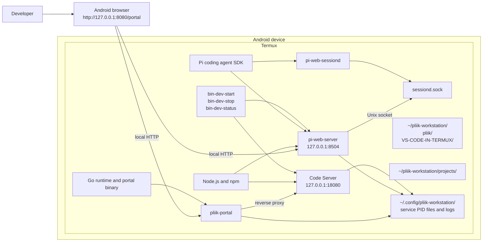
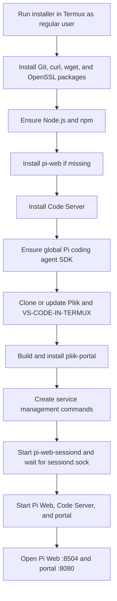

# Pliik Workstation Architecture

The installer runs Pi Web, Code Server, and the Go management portal directly in Termux. It does not start QEMU or Docker.

## Runtime architecture

The installer installs Code Server through npm, switches to Node.js 24 LTS, and launches it on `127.0.0.1:18080` with authentication disabled. A Node preload shim maps Termux's `android` platform identifier to `linux` for VS Code's PTY host. The portal reverse-proxies Code Server at `/` so its editor, WebSocket, and terminal traffic can be reached through the portal URL. Pi Web instead has its own direct loopback URL at port 8504, linked from the admin page; the portal calls its local API to register cloned project folders, but does not proxy Pi Web's UI. The installer also launches `pi-web-server`, `pi-web-sessiond`, and the Go portal, supplies `PI_WEB_PI_PACKAGE_DIR` to the Pi web processes, and waits for `~/.pi-web/sessiond.sock` before starting the web server. It builds the portal from `portal/` and installs the executable at `$PREFIX/bin/pliik-portal`. Management commands are written to `$PREFIX/bin` and start, stop, and report status for the services.

## Installation and startup flow

## Components and paths

| Component | Location or responsibility |
|---|---|
| Pliik repository | `~/pliik-workstation/pliik`; workstation checkout |
| VS-CODE-IN-TERMUX | `~/pliik-workstation/VS-CODE-IN-TERMUX`; reference checkout |
| Projects directory | `~/pliik-workstation/projects`; shared by Code Server and registered in Pi Web when cloned through the portal |
| Runtime | Node.js/npm, Go, globally installed `pi-web`, Code Server, and Pi SDK packages |
| Code Server | `127.0.0.1:18080`, proxied through the portal at `http://127.0.0.1:8080/` |
| Pi Web | `http://127.0.0.1:8504`, also shown in the portal admin dashboard |
| Management portal | `$PREFIX/bin/pliik-portal`, accessed at `http://127.0.0.1:8080/portal` (unauthenticated, loopback only) |
| Server state and logs | PID files and logs for Pi Web, Code Server, and portal under `~/.config/pliik-workstation/` |
| Session daemon state and log | `~/.config/pliik-workstation/pi-web-sessiond.pid` and `pi-web-sessiond.log` |
| Session daemon socket | `~/.pi-web/sessiond.sock` |
| Management commands | `$PREFIX/bin/bin-dev-start`, `bin-dev-stop`, `bin-dev-status` |
| Web app | Pi Web at `http://127.0.0.1:8504`; Code Server through portal `/` |

The Go portal source is under `portal/`; the installer builds it and installs the executable to `$PREFIX/bin/pliik-portal`.

## Operational notes

- Run the installer in Termux as a regular, non-root user.
- The start command acquires an optional Termux wakelock; disable Android battery optimization for Termux to reduce background process suspension.
- The portal and proxied Code Server are unauthenticated. Keep the listener on loopback; do not expose it to a LAN, public network, or untrusted users because the admin page can manage GitHub credentials and projects.
- The installer clones the two repositories under `~/pliik-workstation`; it does not configure QEMU or Docker.
