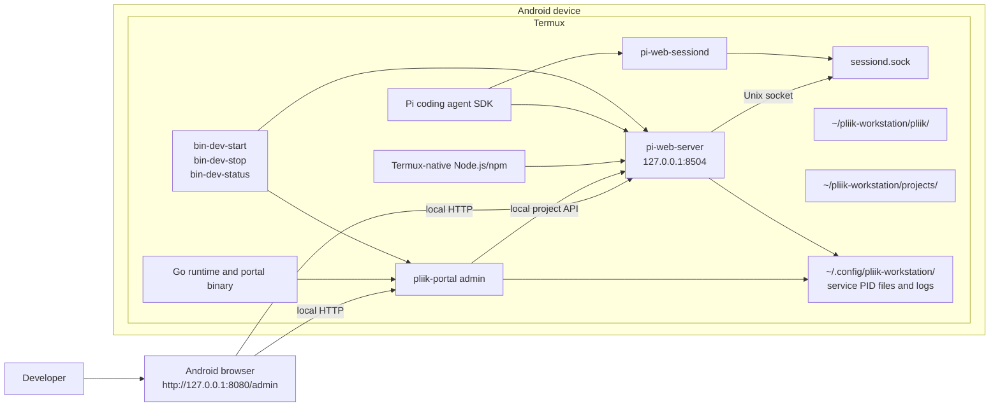
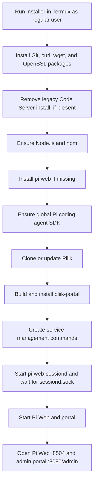

# Pliik Workstation Architecture

The installer runs Pi Web and the Go administration portal directly in Termux. It does not install or run Code Server or another browser-based editor.

## Runtime architecture

The portal is available only through the loopback listener at `127.0.0.1:8080`. Its sole management page is `/admin`; `/` and the former `/portal` URL redirect there. Pi Web has its own loopback URL at port 8504. The portal uses Pi Web's local project API to register cloned repository folders; it does not proxy Pi Web or provide an editor/workspace interface.

The installer launches `pi-web-server`, `pi-web-sessiond`, and the Go portal, supplies `PI_WEB_PI_PACKAGE_DIR` to the Pi Web processes, and waits for `~/.pi-web/sessiond.sock` before starting the web server. It builds the portal from `portal/` and installs the executable at `$PREFIX/bin/pliik-portal`. Management commands are written to `$PREFIX/bin` and start, stop, and report status for the services. On upgrades, the installer also stops and uninstalls the former global Code Server package and removes its Termux platform shim.

## Installation and startup flow

## Components and paths

| Component | Location or responsibility |
|---|---|
| Pliik repository | `~/pliik-workstation/pliik`; workstation checkout |
| Projects directory | `~/pliik-workstation/projects`; repository folders registered with Pi Web |
| Runtime | Node.js/npm, Go, globally installed `pi-web`, and Pi SDK packages |
| Pi Web | `http://127.0.0.1:8504` |
| Management portal | `$PREFIX/bin/pliik-portal`, accessed at `http://127.0.0.1:8080/admin` (unauthenticated, loopback only) |
| Server state and logs | PID files and logs for Pi Web and portal under `~/.config/pliik-workstation/` |
| Session daemon state and log | `~/.config/pliik-workstation/pi-web-sessiond.pid` and `pi-web-sessiond.log` |
| Session daemon socket | `~/.pi-web/sessiond.sock` |
| Management commands | `$PREFIX/bin/bin-dev-start`, `bin-dev-stop`, `bin-dev-status` |

The Go portal source is under `portal/`; the installer builds it and installs the executable to `$PREFIX/bin/pliik-portal`.

## Operational notes

- Run the installer in Termux as a regular, non-root user.
- Pi Web and the administration portal are local services. Do not expose them to a LAN, public network, or untrusted users. The portal can manage GitHub credentials and projects and has no authentication.
- The start command acquires an optional Termux wakelock; disable Android battery optimization for Termux to reduce background process suspension.
- The installer keeps project data under `~/pliik-workstation/projects`; removing Code Server does not delete existing repository folders.
