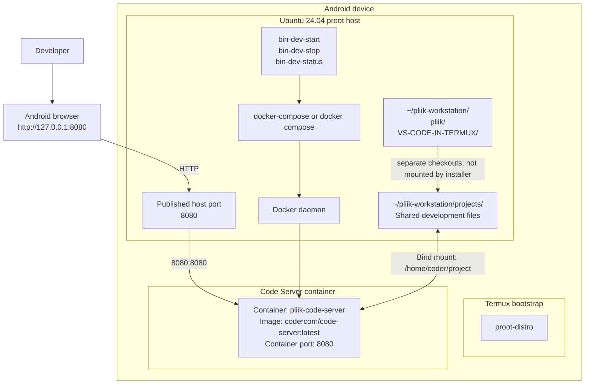
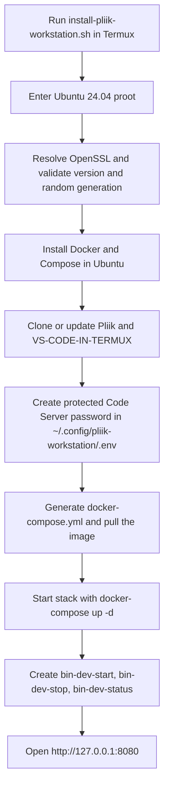

# Pliik Workstation Architecture

Pliik Workstation uses Termux to bootstrap an Ubuntu 24.04 proot, then installs Docker and Docker Compose directly in that environment. Code Server is deployed from a Compose stack instead of booting a QEMU VM or relying on the old `termux-qemu-docker` workflow.

## Runtime architecture

The installer now uses Docker Compose directly. The Compose file is generated in the user config directory and runs the Code Server container on the local forwarded port `http://127.0.0.1:8080`, without building or managing a QEMU VM.

## Installation and startup flow

## Components and paths

| Component | Location or responsibility |
|---|---|
| Pliik repository | `~/pliik-workstation/pliik`; main project checkout |
| VS-CODE-IN-TERMUX | `~/pliik-workstation/VS-CODE-IN-TERMUX`; reference checkout |
| Compose file | `~/.config/pliik-workstation/docker-compose.yml`; generated by the installer |
| Projects directory | `~/pliik-workstation/projects`; the only host directory mounted into Code Server |
| Code Server password | `~/.config/pliik-workstation/.env`; created with mode `600` |
| Management commands | `$PREFIX/bin/bin-dev-start`, `bin-dev-stop`, `bin-dev-status` |

The installer mounts `~/pliik-workstation/projects` at `/home/coder/project` in the container. The Pliik and reference checkouts are siblings of `projects`, so they are **not visible in Code Server by default**. Put working copies under `projects`, or deliberately change the bind mounts if Code Server should edit those checkouts directly.

## Repository responsibilities

| Repository | Responsibility |
|---|---|
| [mutualendemic/pliik](https://github.com/mutualendemic/pliik) | Workstation installer and architecture documentation |
| [Skynetfc/VS-CODE-IN-TERMUX](https://github.com/Skynetfc/VS-CODE-IN-TERMUX) | Reference implementation checkout |
| [docker/compose](https://github.com/docker/compose) | Orchestrates the Code Server stack |
| [coder/code-server](https://github.com/coder/code-server) | Browser-based VS Code environment running in Docker |

## Security and operational notes

- Code Server uses a generated password; keep `.env` private and never commit it.
- The installer does not embed GitHub credentials. Authenticate separately with `gh auth login` when private repository access is needed.
- Access Code Server through the local forwarded port; do not expose it on a public interface without adding an authentication and network-security review.
- The optional Pliik application container is not deployed by this installer. It needs a valid Dockerfile, known runtime dependencies, and a confirmed application port.
- Use the Docker Compose stack for service lifecycle management instead of the previous QEMU VM workflow.

## Upstream projects

- https://github.com/mutualendemic/pliik
- https://github.com/Skynetfc/VS-CODE-IN-TERMUX
- https://github.com/docker/compose
- https://github.com/coder/code-server
