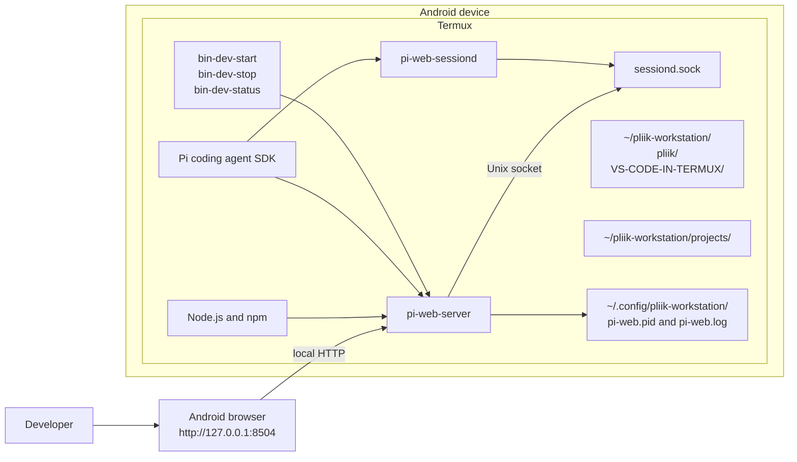
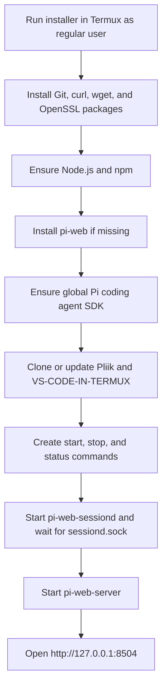

# Pliik Workstation Architecture

The installer runs the browser-based `pi-web` app directly in Termux. It does not start QEMU, Docker, Code Server, or the separate Go portal.

## Runtime architecture

The installer launches both `pi-web-server` and `pi-web-sessiond` as Termux processes, supplies `PI_WEB_PI_PACKAGE_DIR` to each, and waits for `~/.pi-web/sessiond.sock` before starting the web server. It manages these processes directly because `pi-web install` requires systemd or LaunchAgents, which Termux does not provide. The management commands are written to `$PREFIX/bin`.

## Installation and startup flow

## Components and paths

| Component | Location or responsibility |
|---|---|
| Pliik repository | `~/pliik-workstation/pliik`; workstation checkout |
| VS-CODE-IN-TERMUX | `~/pliik-workstation/VS-CODE-IN-TERMUX`; reference checkout |
| Projects directory | `~/pliik-workstation/projects`; created for development projects |
| Runtime | Node.js/npm and globally installed `pi-web` and Pi SDK packages |
| Server state and log | `~/.config/pliik-workstation/pi-web.pid` and `pi-web.log` |
| Session daemon state and log | `~/.config/pliik-workstation/pi-web-sessiond.pid` and `pi-web-sessiond.log` |
| Session daemon socket | `~/.pi-web/sessiond.sock` |
| Management commands | `$PREFIX/bin/bin-dev-start`, `bin-dev-stop`, `bin-dev-status` |
| Web app | `pi-web-server`, accessed at `http://127.0.0.1:8504` |

The Go portal under `portal/` is a separate component and is not built or launched by the current installer.

## Operational notes

- Run the installer in Termux as a regular, non-root user.
- The start command acquires an optional Termux wakelock; disable Android battery optimization for Termux to reduce background process suspension.
- Keep the browser app limited to trusted users. Review its authentication and network binding before exposing it beyond the device.
- The installer clones the two repositories under `~/pliik-workstation`; it does not configure QEMU or Docker.
