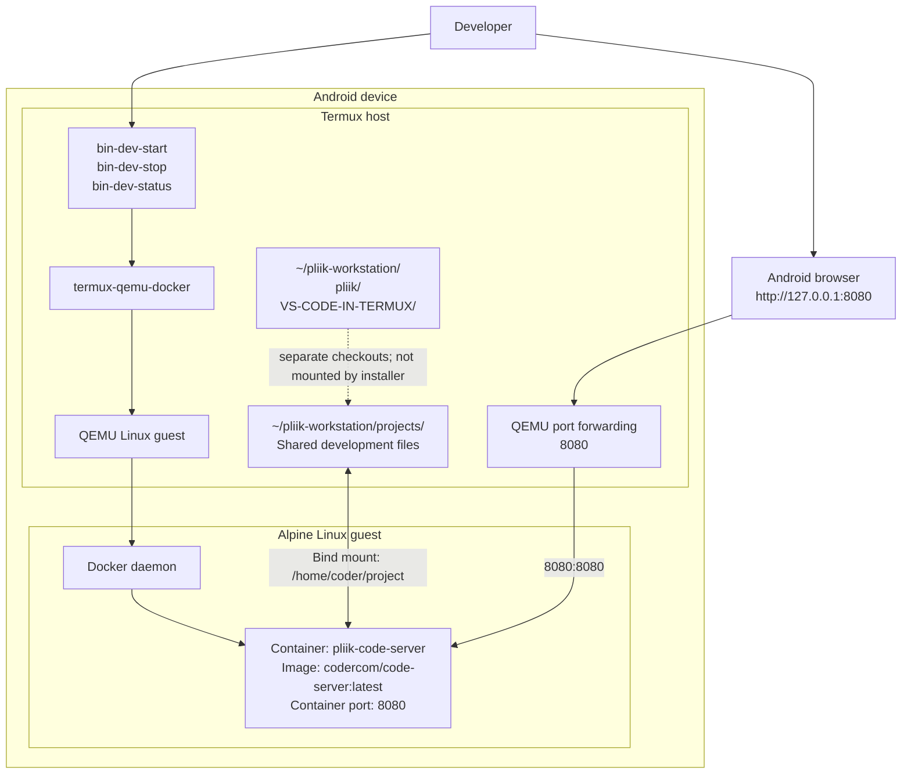
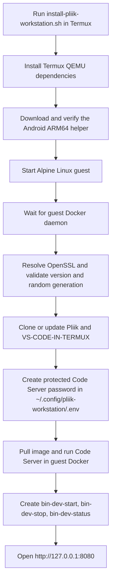

# Pliik Workstation Architecture

Pliik Workstation runs the QEMU manager in Termux and runs Docker and Code Server inside its Alpine Linux guest. It does not install or enter a `proot-distro` container.

## Runtime architecture

The installer builds and configures `termux-qemu-docker` in Termux, then forwards Docker commands to the Linux guest. The helper provides the guest's port forwarding and shared-directory integration.

## Installation and startup flow

## Components and paths

| Component | Location or responsibility |
|---|---|
| Pliik repository | `~/pliik-workstation/pliik`; main project checkout |
| VS-CODE-IN-TERMUX | `~/pliik-workstation/VS-CODE-IN-TERMUX`; reference checkout |
| QEMU helper | `$PREFIX/bin/termux-qemu-docker`; verified Android ARM64 release binary |
| QEMU guest state | `~/.termux-qemu-docker`; managed by the helper |
| Projects directory | `~/pliik-workstation/projects`; shared with Code Server through the helper |
| Code Server password | `~/.config/pliik-workstation/.env`; created with mode `600` |
| Management commands | `$PREFIX/bin/bin-dev-start`, `bin-dev-stop`, `bin-dev-status` |

The installer shares `~/pliik-workstation/projects` at `/home/coder/project` in the container. The Pliik and reference checkouts are siblings of `projects`, so they are **not visible in Code Server by default**. Put working copies under `projects` if Code Server should edit them.

## Repository responsibilities

| Repository | Responsibility |
|---|---|
| [mutualendemic/pliik](https://github.com/mutualendemic/pliik) | Workstation installer and architecture documentation |
| [Skynetfc/VS-CODE-IN-TERMUX](https://github.com/Skynetfc/VS-CODE-IN-TERMUX) | Reference implementation checkout |
| [luisdavim/termux-qemu-docker](https://github.com/luisdavim/termux-qemu-docker) | QEMU guest lifecycle and Docker command forwarding |
| [coder/code-server](https://github.com/coder/code-server) | Browser-based VS Code environment running in Docker |

## Security and operational notes

- Code Server uses a generated password; keep `.env` private and never commit it.
- The installer does not embed GitHub credentials. Authenticate separately with `gh auth login` when private repository access is needed.
- Access Code Server through the local forwarded port; do not expose it on a public interface without adding an authentication and network-security review.
- The optional Pliik application container is not deployed by this installer. It needs a valid Dockerfile, known runtime dependencies, and a confirmed application port.
- Docker runs in the QEMU guest, not in Termux or a proot container.

## Upstream projects

- https://github.com/mutualendemic/pliik
- https://github.com/Skynetfc/VS-CODE-IN-TERMUX
- https://github.com/luisdavim/termux-qemu-docker
- https://github.com/coder/code-server
