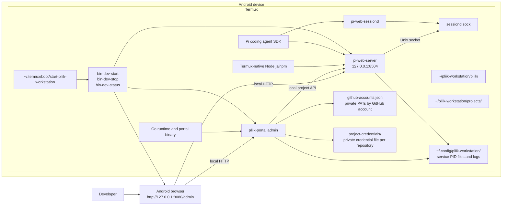
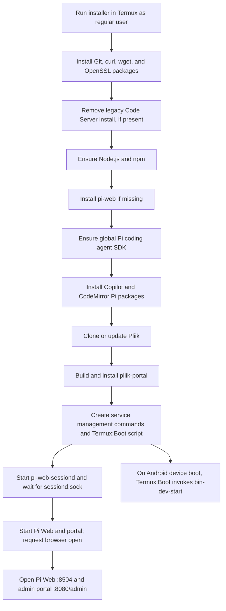

# Pliik Workstation Architecture

The installer runs Pi Web and the Go administration portal directly in Termux and installs a CodeMirror plugin for browser-based source editing. It does not install or run Code Server.

## Runtime architecture

The portal is available only through the loopback listener at `127.0.0.1:8080`. Its sole management page is `/admin`; `/` and the former `/portal` URL redirect there. Pi Web has its own loopback URL at port 8504. The portal stores multiple GitHub PATs in a private account store, associates each project with the selected account, and writes a private credential file for that repository. It uses Pi Web's local project API to register cloned repository folders; it does not proxy Pi Web or provide an editor/workspace interface. The installer also adds the CodeMirror Editor Pi package, which provides browser-only editing in Pi Web's Files panel.

The installer launches `pi-web-server`, `pi-web-sessiond`, and the Go portal, supplies `PI_WEB_PI_PACKAGE_DIR` to the Pi Web processes, and waits for `~/.pi-web/sessiond.sock` before starting the web server. It builds the portal from `portal/` and installs the executable at `$PREFIX/bin/pliik-portal`. Management commands are written to `$PREFIX/bin` and start, stop, and report status for the services; `bin-dev-start` also asks Android to open the admin URL with `am start -a android.intent.action.VIEW`. The installer creates `~/.termux/boot/start-pliik-workstation`, which delegates to `bin-dev-start` when the Termux:Boot Android app runs after device boot, and adds the same hook once to `~/.bashrc` for interactive Bash shells. Reinstalling does not duplicate the `.bashrc` line. Termux:Boot must be installed separately and opened once. Android may block the browser launch from a background boot task while still allowing the services to start. On upgrades, the installer also stops and uninstalls the former global Code Server package and removes its Termux platform shim.

## Installation and startup flow

## Components and paths

| Component | Location or responsibility |
|---|---|
| Pliik repository | `~/pliik-workstation/pliik`; workstation checkout |
| Projects directory | `~/pliik-workstation/projects`; repository folders registered with Pi Web |
| Runtime | Node.js/npm, Go, globally installed `pi-web`, Pi SDK packages, and the CodeMirror editor Pi package |
| Pi Web | `http://127.0.0.1:8504` |
| Management portal | `$PREFIX/bin/pliik-portal`, accessed at `http://127.0.0.1:8080/admin` (unauthenticated, loopback only) |
| Server state and logs | PID files and logs for Pi Web and portal under `~/.config/pliik-workstation/` |
| GitHub accounts | `~/.config/pliik-workstation/github-accounts.json`; PATs stored with private file permissions |
| Git credentials | `~/.config/pliik-workstation/project-credentials/`; one private credential file per repository |
| Session daemon state and log | `~/.config/pliik-workstation/pi-web-sessiond.pid` and `pi-web-sessiond.log` |
| Session daemon socket | `~/.pi-web/sessiond.sock` |
| Management commands | `$PREFIX/bin/bin-dev-start`, `bin-dev-stop`, `bin-dev-status` |
| Termux startup hooks | `~/.termux/boot/start-pliik-workstation` for device boot; one invocation in `~/.bashrc` for interactive shells |
| Termux:Boot requirement | Separate Termux:Boot app, installed and opened once |
| Boot startup log | `~/.config/pliik-workstation/boot.log` |

The Go portal source is under `portal/`; the installer builds it and installs the executable to `$PREFIX/bin/pliik-portal`.

## Operational notes

- Run the installer in Termux as a regular, non-root user.
- Pi Web and the administration portal are local services. Do not expose them to a LAN, public network, or untrusted users. The portal can manage GitHub credentials and projects and has no authentication.
- The start command acquires an optional Termux wakelock and requests that Android open the management portal. It runs from both the Termux:Boot hook on device boot and the `.bashrc` hook when an interactive shell opens; Android may block opening the browser from the background. Disable Android battery optimization for Termux to reduce background process suspension.
- The installer keeps project data under `~/pliik-workstation/projects`; removing Code Server does not delete existing repository folders.
